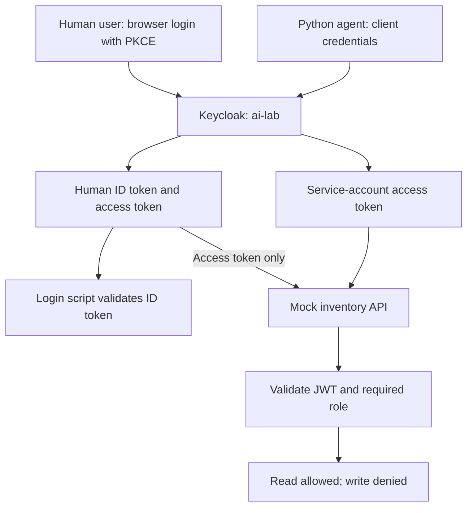

# AI Identity Management Lab: Keycloak, OAuth 2.0 and OpenID Connect

## Why I built this lab

I wanted to understand how to securely control what an AI agent is allowed to do and what evidence would be needed to prove who authorized its access.

To start, I built a local identity lab using Keycloak, Docker and Python. A Python script represented an agent requesting access to a mock inventory API. I gave it read-only access, tested whether the API enforced that restriction, and deliberately changed permissions and token settings to observe failures.

I then added a separate browser login for a human user using OpenID Connect and Authorization Code with PKCE S256.

This project helped me connect familiar IAM practices—least privilege, authentication, authorization and access removal—to non-human identities and AI tool access.

**Scope:** The agent is a deterministic Python tool caller, with no connected AI model. Human login and service-account access were tested separately. This lab does not yet demonstrate a human delegating a specific action to an agent or a complete audit trail proving who approved that action.

## Scenario

A mock inventory contains a service named `mock-ai-service` with a human owner. An automated inventory reader needs to retrieve that information but must not receive permission to write.

Keycloak issues an access token to the agent's service account. The API validates the token and checks the required client role before allowing the request. A separate human test account also receives read-only access through browser login.

The owner in the mock inventory is descriptive metadata. It is not evidence of approval or delegation.

## Technologies and identities

| Component | Purpose |
| --- | --- |
| Docker Desktop and Docker Compose | Run the local services on macOS |
| Keycloak realm `ai-lab` | Manage the lab identities, clients and roles |
| Client `inventory-agent` | Authenticate the automated script using client credentials |
| Client `mock-tool-api` | Represent the protected inventory API and define its roles |
| Client `human-login-lab` | Support a public OIDC client using Authorization Code with PKCE S256 |
| User `keneisha-lab` | Test human browser login and API access |
| Python and PyJWT | Request tokens, validate JWTs and call the API |

## Identity flows



The ID token identifies the user to the login client. The separate access token is sent to the API. The service-account flow does not impersonate the human user.

## What I configured and tested

### 1. Service-account authentication

I deployed Keycloak locally and inspected the `inventory-agent` client. Client authentication and service accounts were enabled. Browser standard flow and direct access grants were disabled for this client.

The Python agent requested an access token using the OAuth 2.0 client credentials grant and used it to call the mock API.

### 2. Least-privilege API access

I assigned `inventory.read` from `mock-tool-api` to the agent's service account. I left `inventory.write` unassigned.

The API checked the token's signature using Keycloak's public signing keys, restricted the accepted algorithm to RS256, validated issuer, audience and expiration, and required the relevant claims. It then checked the client role for the requested operation.

A read returned `200`. A write attempt returned `403` because the identity lacked write permission. The mock API does not persist changes.

### 3. Access removal

I removed `inventory.read` and ran the agent again so it requested a fresh token. The read returned `403`.

The script marked that row as failed because its normal expected result was `200`. For this negative test, `403` was the intended outcome. I then reassigned the read role and moved on to the next test.

This test showed that removing a role affected newly issued tokens. It did not test immediate revocation of a token that had already been issued.

### 4. Audience validation and troubleshooting

I changed the explicit audience mapper to `wrong-api`, expecting the API to return `401`. Instead, the initial read still returned `200`.

The default `roles` client scope was also adding the correct API audience based on the assigned client role. Changing the explicit mapper alone had not removed the valid audience.

I removed the `roles` scope assignment from `inventory-agent`, keeping its dedicated `api-roles` mapper. With the explicit audience still set incorrectly, both read and write requests returned `401`.

I then restored the explicit audience to `mock-tool-api` and cleared the custom audience. The default `roles` scope stayed removed from the agent client; its dedicated role mapper supplied the API role claim.

My main lesson was to account for every mapper contributing to a token claim before deciding whether a validation test had succeeded.

### 5. Token expiration

I temporarily modified the agent to call the API, wait for the token's reported lifetime plus five seconds, and send the same token again.

The first request returned `200`. After a 125-second wait, the same token returned `401`.

The expiration check used a temporary code block. Remove that block before running the original baseline suite again; a final baseline restoration run is not included in the evidence recorded here.

### 6. Human OIDC login

I created the separate public client `human-login-lab`, enabled Standard flow, and required PKCE S256. I registered the exact callback URI `http://localhost:8765/callback` and gave the test user `inventory.read` access.

The browser-login script checked callback state, exchanged the authorization code with the PKCE verifier, and validated the ID token's signature, issuer, audience, time claims and nonce. It used the access token for API requests.

The first attempt reached a refused localhost connection after profile setup. I restarted the listener and used a fresh login link. I subsequently confirmed that the browser test passed. The final browser output was not pasted into the session, so its success is recorded as user-confirmed rather than a captured transcript.

## Test results

| Test | Expected | Recorded result | Evidence status |
| --- | --- | --- | --- |
| OIDC discovery issuer | Configured issuer matches | PASS | Terminal output captured |
| Agent reads inventory | `200` | `200` | Terminal output captured |
| Agent attempts write without write role | `403` | `403` | Terminal output captured |
| Missing bearer token | `401` | `401` | Terminal output captured |
| Malformed token | `401` | `401` | Terminal output captured |
| Tampered token signature | `401` | `401` | Terminal output captured |
| Incorrect client secret | `401` | `401` | Terminal output captured |
| Read role removed; fresh token requested | `403` | `403` | Terminal output captured |
| Wrong audience after isolating mappers | `401` for read and write | `401` for both | Terminal output captured |
| Same token before expiration | `200` | `200` | Terminal output captured |
| Same token after expiration | `401` | `401` | Terminal output captured |
| Browser OIDC login and API permission tests | Validation passes; read `200`, write `403` | Test passed | User-confirmed; attach final output |

## Skills I gained

- Deploying local identity services with Docker Compose.
- Configuring OAuth clients, service accounts and client roles in Keycloak.
- Applying least privilege to automated API access.
- Distinguishing authentication failures (`401`) from permission failures (`403`).
- Validating signed JWTs and understanding issuer, audience and expiration claims.
- Troubleshooting overlapping audience mappers and client scopes.
- Configuring human OIDC login using Authorization Code with PKCE S256.
- Understanding state, nonce and the different purposes of ID tokens and access tokens.
- Designing negative tests and recording expected versus actual results.

## Connection to AI Identity Management

An AI agent that calls a tool needs an identity and an enforceable permission boundary. This lab let me practice that boundary with a simple Python script before adding the complexity of an AI model.

I learned to separate three questions:

1. **Which identity made the request?** The service-account or human token identifies the caller.
2. **What is that identity allowed to do?** API roles limit the permitted operations.
3. **Who approved this particular agent action?** This requires evidence beyond successful authentication and a descriptive owner field.

The first two questions were exercised here. A future extension would link a human approval to a specific agent action, record the relationship in audit events, and test whether the agent can exceed or reuse that authorization.

## Repository files

Place the implementation files together at the repository root:

| File or folder | Contents |
| --- | --- |
| `README.md` | This lab story |
| `compose.yaml` | Keycloak, mock API and agent services |
| `compose.oidc.yaml` | Browser-login service extension |
| `Dockerfile` | Python container build |
| `requirements.txt` | Python dependency |
| `realm.json` | Starter realm and disposable fixture configuration |
| `agent.py` | Service-account token requests and baseline API tests |
| `api.py` | JWT validation and role enforcement |
| `browser_login.py` | Human OIDC login and API tests |
| `screenshots/` | Redacted configuration and test evidence |

The starter realm export does not automatically include later console changes or the new browser client. Reproducing the final lab requires applying the documented configuration changes or preparing a sanitized final export. Do not describe the original export as the final configuration.

## Running the lab

With Docker Desktop running, open a terminal in the folder containing the implementation files:

```powershell
docker compose up -d keycloak
docker compose up -d --build api
docker compose run --rm --build agent
```

After configuring the human client and test user:

```powershell
docker compose -f compose.yaml -f compose.oidc.yaml run --rm --service-ports --build browser-login
```

Keep the terminal running while completing browser login. Use the current printed login link; the one-shot callback listener times out after five minutes.

To stop the services while preserving the lab volume:

```powershell
docker compose down
```

## Screenshots to add

These filenames are suggested evidence locations, not screenshots already included in this repository.

| Suggested filename | What to show |
| --- | --- |
| `screenshots/01-agent-capabilities.png` | Client authentication and service-account settings |
| `screenshots/02-read-only-role.png` | Assigned `inventory.read` role |
| `screenshots/03-baseline-tests.png` | Six baseline test results |
| `screenshots/04-access-removal.png` | Read returns `403` after role removal |
| `screenshots/05-audience-mismatch.png` | Read and write return `401` with wrong audience |
| `screenshots/06-expiration-test.png` | Same token returns `200`, then `401` after the wait |
| `screenshots/07-browser-pkce.png` | Public browser client and PKCE S256 configuration |
| `screenshots/08-browser-results.png` | Final browser-login validation and API results |

Crop out credentials, full tokens, login links, callback URLs and unrelated personal information. Once each file is uploaded, embed it beneath the relevant section using a relative Markdown image link.

## Boundaries and next steps

This is a localhost development lab with disposable identities, mock data and fixture secrets. It does not represent a production deployment. Never reuse its fixture passwords or secrets outside the lab.

Not implemented or demonstrated:

- A connected language model or autonomous reasoning loop.
- OAuth token exchange or human-to-agent delegation.
- Per-action approval, consent receipts or a durable authorization audit trail.
- Immediate invalidation of already-issued access tokens after permission removal.
- Browser session management, refresh-token handling or logout in the one-shot login script.
- Deliberate negative tests for state or nonce tampering against the live Keycloak deployment.

The completed work demonstrates practical authentication and authorization controls for a simulated agent and a separate human login. The next goal is to connect those controls to accountable human authorization for agent actions.
